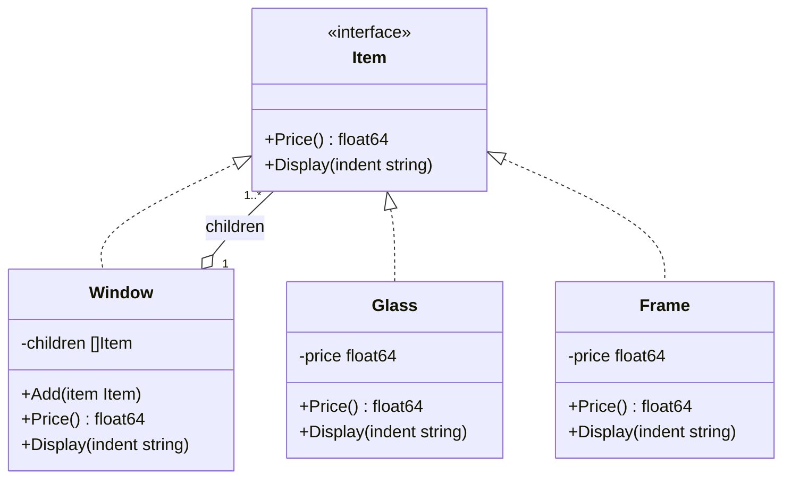

# composite-window

Go implementation of the Composite design pattern, modeled on the lecture
example: a `Window` is composed of `Glass` and `Frame` parts, and can itself
contain nested `Window`s.

## UML Diagram



## Structure

- `item.go` — `Item` interface (`Price() float64`, `Display(indent string)`), the Component role
- `leaf.go` — `Glass`, `Frame`: Leaf implementations with a fixed price
- `window.go` — `Window`: Composite implementation holding `[]Item` children
- `main.go` — builds an example window tree and prints its structure and total price
- `item_test.go` — tests for `Price()` on a single leaf, a composite, and a nested composite

## How it works

- `Item` is the **Component**: both leaves and composites implement `Price()` and `Display(indent)`, so a caller never needs to know which one it's holding.
- `Glass` and `Frame` are **Leaves**: `Price()` just returns their fixed price, `Display()` prints one line.
- `Window` is the **Composite**: `Add(item Item)` appends a child to its internal `[]Item`. `Price()` recursively sums `Price()` over all children, so a `Window` nested inside another `Window` contributes its own subtotal to the parent's total. `Display(indent)` prints itself, then calls `Display` on each child with a deeper indent, producing the tree view.
- Because `Window` itself satisfies `Item`, it can be added as a child of another `Window` — this is what lets windows nest arbitrarily deep without any special-casing in the client code.

## Example

`main.go` builds this tree (Window 1 contains Glass 1, Frame 1, and a nested Window 2):

```
Window 1
├── Glass 1  (90.00)
├── Frame 1  (35.00)
└── Window 2
    ├── Glass 2  (40.00)
    └── Frame 2  (15.00)
```

Running `go run .` prints:

```
+ Window 1 (Window): 180.00
  - Glass 1 (Glass): 90.00
  - Frame 1 (Frame): 35.00
  + Window 2 (Window): 55.00
    - Glass 2 (Glass): 40.00
    - Frame 2 (Frame): 15.00

Total price: 180.00
```

Window 2's price (55.00 = 40.00 + 15.00) is computed first and then rolled into Window 1's total (180.00 = 90.00 + 35.00 + 55.00) — the recursive part of the Composite pattern.

## Requirements

- Go 1.21+

## Commands

```bash
go vet ./...
```
```bash
go build ./...
```
```bash
go test ./... -v
```
```bash
go run .
```

## Source Code

Full Go source listing: [SOURCE.md](SOURCE.md)
