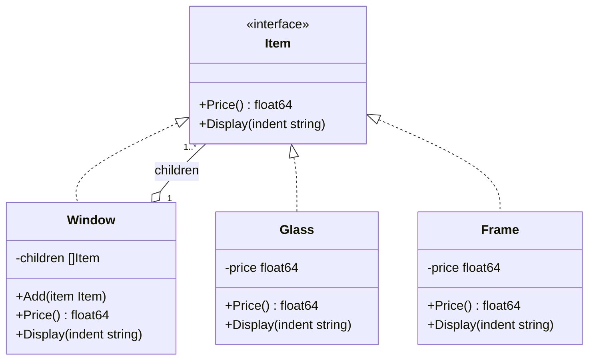

# composite-window

Go implementation of the Composite design pattern, modeled on the lecture
example: a `Window` is composed of `Glass` and `Frame` parts, and can itself
contain nested `Window`s.

## UML Diagram



## Structure

- `item.go` — `Item` interface (`Price() float64`, `Display(indent string)`), the Component role
- `leaf.go` — `Glass`, `Frame`: Leaf implementations with a fixed price
- `window.go` — `Window`: Composite implementation holding `[]Item` children
- `main.go` — builds an example window tree and prints its structure and total price
- `item_test.go` — tests for `Price()` on a single leaf, a composite, and a nested composite

## How it works

- `Item` is the **Component**: both leaves and composites implement `Price()` and `Display(indent)`, so a caller never needs to know which one it's holding.
- `Glass` and `Frame` are **Leaves**: `Price()` just returns their fixed price, `Display()` prints one line.
- `Window` is the **Composite**: `Add(item Item)` appends a child to its internal `[]Item`. `Price()` recursively sums `Price()` over all children, so a `Window` nested inside another `Window` contributes its own subtotal to the parent's total. `Display(indent)` prints itself, then calls `Display` on each child with a deeper indent, producing the tree view.
- Because `Window` itself satisfies `Item`, it can be added as a child of another `Window` — this is what lets windows nest arbitrarily deep without any special-casing in the client code.

## Example

`main.go` builds this tree (Window 1 contains Glass 1, Frame 1, and a nested Window 2):

```
Window 1
├── Glass 1  (90.00)
├── Frame 1  (35.00)
└── Window 2
    ├── Glass 2  (40.00)
    └── Frame 2  (15.00)
```

Running `go run .` prints:

```
+ Window 1 (Window): 180.00
  - Glass 1 (Glass): 90.00
  - Frame 1 (Frame): 35.00
  + Window 2 (Window): 55.00
    - Glass 2 (Glass): 40.00
    - Frame 2 (Frame): 15.00

Total price: 180.00
```

Window 2's price (55.00 = 40.00 + 15.00) is computed first and then rolled into Window 1's total (180.00 = 90.00 + 35.00 + 55.00) — the recursive part of the Composite pattern.

## Requirements

- Go 1.21+

## Commands

```bash
go vet ./...
```
```bash
go build ./...
```
```bash
go test ./... -v
```
```bash
go run .
```

## Source Code

### go.mod

```go
module composite-window

go 1.21
```

### item.go

```go
package main

// Item is the Component in the Composite pattern: both leaves (Glass,
// Frame) and composites (Window) implement it, so callers treat single
// parts and assemblies uniformly.
type Item interface {
	Price() float64
	Display(indent string)
}
```

### leaf.go

```go
package main

import "fmt"

// Glass is a Leaf: a fixed-price part with no children.
type Glass struct {
	Name  string
	price float64
}

func NewGlass(name string, price float64) *Glass {
	return &Glass{Name: name, price: price}
}

func (g *Glass) Price() float64 {
	return g.price
}

func (g *Glass) Display(indent string) {
	fmt.Printf("%s- %s (Glass): %.2f\n", indent, g.Name, g.price)
}

// Frame is a Leaf: a fixed-price part with no children.
type Frame struct {
	Name  string
	price float64
}

func NewFrame(name string, price float64) *Frame {
	return &Frame{Name: name, price: price}
}

func (f *Frame) Price() float64 {
	return f.price
}

func (f *Frame) Display(indent string) {
	fmt.Printf("%s- %s (Frame): %.2f\n", indent, f.Name, f.price)
}
```

### window.go

```go
package main

import "fmt"

// Window is the Composite: it holds 1..* child Items (leaves or nested
// Windows) and satisfies the Item interface itself, so a Window can be
// a child of another Window.
type Window struct {
	Name     string
	children []Item
}

func NewWindow(name string) *Window {
	return &Window{Name: name}
}

func (w *Window) Add(item Item) {
	w.children = append(w.children, item)
}

func (w *Window) Price() float64 {
	total := 0.0
	for _, child := range w.children {
		total += child.Price()
	}
	return total
}

func (w *Window) Display(indent string) {
	fmt.Printf("%s+ %s (Window): %.2f\n", indent, w.Name, w.Price())
	for _, child := range w.children {
		child.Display(indent + "  ")
	}
}
```

### main.go

```go
package main

import "fmt"

func main() {
	subWindow := NewWindow("Window 2")
	subWindow.Add(NewGlass("Glass 2", 40.0))
	subWindow.Add(NewFrame("Frame 2", 15.0))

	mainWindow := NewWindow("Window 1")
	mainWindow.Add(NewGlass("Glass 1", 90.0))
	mainWindow.Add(NewFrame("Frame 1", 35.0))
	mainWindow.Add(subWindow)

	mainWindow.Display("")
	fmt.Printf("\nTotal price: %.2f\n", mainWindow.Price())
}
```

### item_test.go

```go
package main

import "testing"

func TestLeafPrice(t *testing.T) {
	g := NewGlass("Glass", 40.0)
	if got := g.Price(); got != 40.0 {
		t.Errorf("Glass.Price() = %.2f, want 40.00", got)
	}
}

func TestWindowPriceSumsChildren(t *testing.T) {
	w := NewWindow("Window")
	w.Add(NewGlass("Glass", 40.0))
	w.Add(NewFrame("Frame", 15.0))

	if got, want := w.Price(), 55.0; got != want {
		t.Errorf("Window.Price() = %.2f, want %.2f", got, want)
	}
}

func TestNestedWindowPrice(t *testing.T) {
	sub := NewWindow("Window 2")
	sub.Add(NewGlass("Glass 2", 40.0))
	sub.Add(NewFrame("Frame 2", 15.0))

	main := NewWindow("Window 1")
	main.Add(NewGlass("Glass 1", 90.0))
	main.Add(NewFrame("Frame 1", 35.0))
	main.Add(sub)

	want := 40.0 + 15.0 + 90.0 + 35.0
	if got := main.Price(); got != want {
		t.Errorf("nested Window.Price() = %.2f, want %.2f", got, want)
	}
}
```
